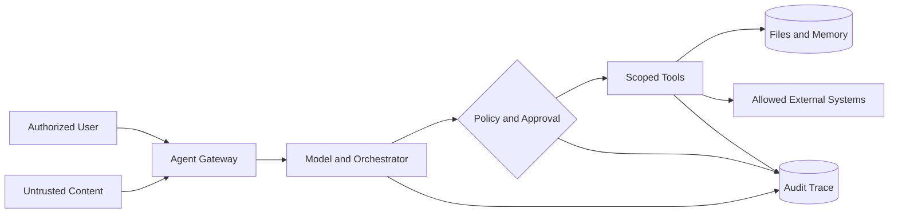

# Agent Threat Model v0.1 / Agent 威胁模型

**Status:** [DESIGN]. Assessment target: an authorized, single-user Hermes-style agent in a container, with LLM, optional memory, terminal and file tools. Real deployed configuration must be independently confirmed.

## 1. Scope and assumptions
**In scope:** user request ingestion, retrieved/untrusted content, model reasoning boundaries, tool invocation, local filesystem, secrets, logging, memory, approval decisions, external channel/connector activation.
**Out of scope:** compromise of provider infrastructure, speculative zero-day vulnerabilities and tests against third-party services.

## 2. Assets, actors and trust
| Asset | Security objective | Risk trigger |
|---|---|---|
| API credentials and session tokens | Confidentiality, constrained use, rotation | Agent reads or emits secrets |
| Files and project data | Correct scope and integrity | Tool accesses unrelated paths |
| Tool execution capability | Least privilege and approval | Untrusted text induces action |
| Memory and retrieval | Provenance and integrity | Lower-trust text persists as policy |
| Agent logs | Evidence integrity, data minimization | No trace or logs contain sensitive data |
| Model/agent dependencies | Integrity and supply-chain awareness | Undocumented component changes |

Actors: owner, authorized operator, untrusted content author, integration maintainer and external service. Even when all participants are benign, accidental overreach matters.

## 3. DFD / 数据流（概念）

## 4. Threat scenarios
| ID | Entry / boundary | Security concern | Impact | Proposed enforcement |
|---|---|---|---|---|
| AS-01 | Retrieved content → agent | Instruction/data confusion | Incorrect tool selection | Provenance tagging + tool authorization |
| AS-02 | Agent → terminal | Unnecessary execution authority | System or file change | Sandbox + allowlist + approval |
| AS-03 | Agent → file tool | Overbroad path access | Confidentiality/integrity loss | Scoped mount & access policy |
| AS-04 | Tool → external service | Over-permissive destinations | Unauthorized transmission | Egress restriction and destination list |
| AS-05 | Conversation → memory | Persistent malicious instruction | Cross-session behavioral drift | Reviewed, attributed memory writes |
| AS-06 | Agent → action | Approval omitted for consequential steps | Unintended side effects | Human-in-the-loop for high-impact tasks |
| AS-07 | Build/dependency → runtime | Untrusted package/plugin | Changed behavior | Dependency inventory and change review |
| AS-08 | Agent → logs | Unverifiable or over-exposed activity | Missed incident/privacy risk | Redacted immutable audit evidence |

## 5. Risk scoring and ownership
Start with likelihood (1–5), impact (1–5), and inherent risk = likelihood × impact. Assign a rationale, owner, target mitigation date, test evidence and residual risk; never treat score as proof of effectiveness. Choose thresholds based on intended use and business context, especially regulated environments.

## 6. Validation boundary
The model must not be treated as a security enforcement point on its own. An agent politely declining a test is not proof the OS, tool broker or credential scope blocks it.

## 7. Next steps
Capture actual assets/entry points, enumerate every tool with its owner and privileges, validate current policies, run benign synthetic test cases and update risk register with observed outcomes.
